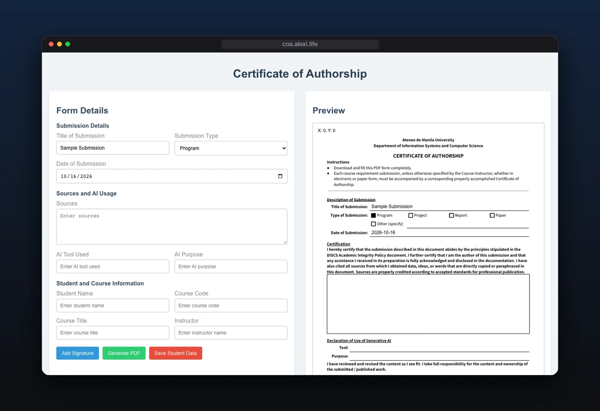

<div align="center">

<br>

# ADMU CoA Maker

**Fill out your DISCS Certificate of Authorship once. Get the PDF.**

Type it in, see the certificate update beside you, sign it, download it.

<a href="https://coa.alexi.life">coa.alexi.life</a> ·
<a href="#features">Features</a> ·
<a href="#run-it-locally">Run it locally</a>

<br>


<br>



</div>

<br>

## Features

- **Live preview.** The certificate fills in beside the form as you type.
- **Sign in the browser.** Draw your signature and it lands on the right line.
- **One-click PDF.** Download a ready-to-submit certificate.
- **Remembers you.** Saves your student details on your device, so the next one takes seconds. Nothing is sent to a server.

<br>

## Run it locally

React · jsPDF · PDF.js · react-signature-canvas

<details>
<summary><b>Setup</b></summary>
<br>

```bash
npm install
npm start
```

</details>

<br>

<div align="center">
<sub>an independent student project · not affiliated with Ateneo de Manila University</sub>
</div>
